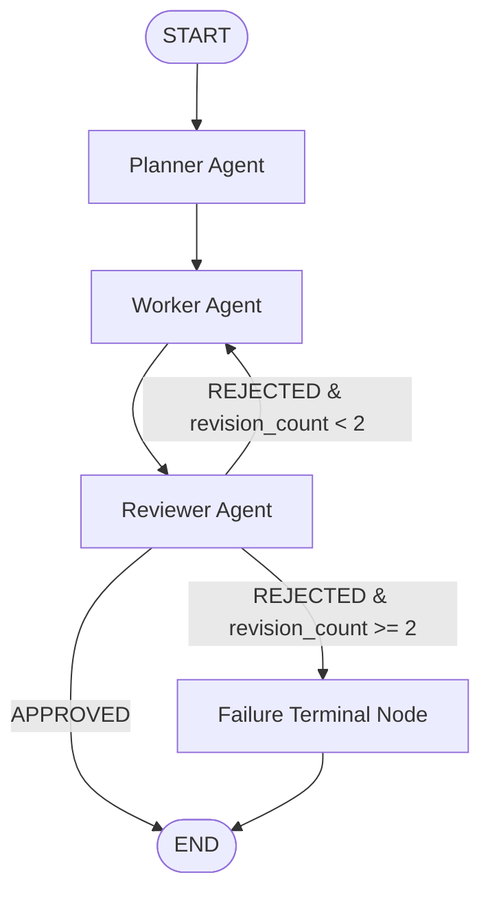

# AgenticX Project 2: Multi-Agent Workflow with LangGraph

[](https://www.python.org/)
[](https://github.com/langchain-ai/langgraph)
[](https://docs.pytest.org/)
[](LICENSE)

---

## 1. Project Title
**Multi-Agent Collaborative Workflow with Stateful Feedback Cycles using LangGraph**

---

## 2. Project Overview
This project implements a multi-agent system using **LangGraph**. A complex problem statement is partitioned across three specialized agents:
- **Planner Agent**: Decomposes user tasks into strategic, sequential execution steps.
- **Worker Agent**: Synthesizes drafts based on the plan and refines its output in response to critique.
- **Reviewer Agent**: Audits submissions against quality, depth, and relevance standards, routing work either forward to completion, backward for revision, or toward terminal failure.

The key design highlight is the **stateful feedback edge**—a conditional loop capable of returning work to the Worker while strictly preventing infinite loops through a deterministic **two-rejection termination threshold**.

---

## 3. Problem Statement
Single-prompt LLM interactions often suffer from hallucinations, surface-level reasoning, and lack of self-correction. While naive multi-agent chains (e.g., $A \rightarrow B \rightarrow C \rightarrow \text{End}$) introduce division of labor, they lack the ability to inspect output, provide corrective feedback, and iteratively refine results.

Conversely, unconstrained iterative feedback loops present high risks of infinite loops, token exhaustion, and unpredictable divergence. This project solves these challenges by implementing an explicit graph-based state machine with:
1. Dynamic self-correction via a reviewer-worker revision cycle.
2. A strict ceiling of two rejections before halting execution in a structured failure state.

---

## 4. What This Project Demonstrates
- **Stateful Agent Graphs**: Explicit state management with LangGraph's `StateGraph` and typed schemas (`TypedDict`).
- **Conditional Branching**: Implementation of runtime decision logic (`route_after_review`) based on agent outputs and iteration counters.
- **Iterative Refinement**: Worker agents dynamically reading feedback from Reviewer agents to rectify flaws.
- **Safe Halting Guarantees**: Formal mitigation of infinite cycles using deterministic threshold routing.
- **Zero-Cost Deterministic Testing**: Complete test isolation allowing automated evaluation of complex agent behavior without consuming external LLM API credits.

---

## 5. Technologies Used
- **Python 3.10+**: Core programming language.
- **LangGraph**: Stateful multi-agent graph orchestration.
- **LangChain Core**: Agent messaging, system/human prompt scaffolding.
- **LangChain Google GenAI / OpenAI**: Optional production LLM integrations.
- **pytest & pytest-asyncio**: Automated deterministic test framework.
- **python-dotenv**: Environment configuration management.

---

## 6. Architecture & Graph Diagram



### Architecture Walkthrough
1. **Entry**: The user inputs a task into `START`, which initializes the shared `WorkflowState`.
2. **Planning**: The `Planner Agent` analyzes the task and produces a 3–5 step structured execution plan (`plan`).
3. **Execution**: The `Worker Agent` executes the plan and generates the draft (`worker_result`).
4. **Evaluation**: The `Reviewer Agent` analyzes the draft.
   - If approved: `review_status = "APPROVED"`, `final_result = worker_result`, workflow moves to `END`.
   - If rejected: `review_status = "REJECTED"`, `revision_count` is incremented, and actionable critique is stored in `review_feedback`.
5. **Conditional Routing**:
   - `revision_count < 2`: Routes backward to `Worker` for revision.
   - `revision_count >= 2`: Routes to `Failure Terminal Node`, setting `error` and ending execution.

---

## 7. Shared State Schema

The workflow operates on a typed dictionary (`WorkflowState`) defined in `app/state.py`.

```
Shared State (WorkflowState)
├── task: str                    # Original user task / problem statement
├── plan: List[str]              # Structured execution steps formulated by Planner
├── worker_result: str           # Working draft / revised output produced by Worker
├── review_status: str           # "APPROVED" or "REJECTED"
├── review_feedback: str         # Detailed critique or rationale from Reviewer
├── revision_count: int          # Tracks number of rejected revisions (0, 1, or 2)
├── final_result: Optional[str]  # Approved deliverable (None on failure)
└── error: Optional[str]         # Terminal error diagnostics (None on success)
```

### Node State Access Matrix

| Node | State Fields Read | State Fields Written |
| :--- | :--- | :--- |
| **Planner** | `task` | `plan` |
| **Worker** | `task`, `plan`, `worker_result`, `review_feedback`, `revision_count` | `worker_result` |
| **Reviewer** | `task`, `plan`, `worker_result`, `revision_count` | `review_status`, `review_feedback`, `revision_count`, `final_result` |
| **Failure** | `revision_count`, `review_feedback` | `error`, `final_result` |

---

## 8. Specialized Agent Responsibilities

### Planner Node (`app/nodes/planner.py`)
- **Input**: User task.
- **Responsibilities**:
  - Understand the domain requirements.
  - Break the task down into 3–5 sequential, actionable steps.
  - Store the step list in `state["plan"]`.
  - **Constraint**: Must *never* directly solve or output the final answer.

### Worker Node (`app/nodes/worker.py`)
- **Input**: `task`, `plan`, `review_feedback`, `revision_count`.
- **Responsibilities**:
  - Execute the planner's structured steps.
  - On initial run: formulate a comprehensive first draft.
  - On revision: read `review_feedback` and directly address every critique to enhance depth, completeness, and clarity.
  - Store the generated draft in `state["worker_result"]`.

### Reviewer Node (`app/nodes/reviewer.py`)
- **Input**: `task`, `plan`, `worker_result`, `revision_count`.
- **Responsibilities**:
  - Audit the draft against relevance, completeness, structural clarity, and task satisfaction.
  - Output decision: `"APPROVED"` or `"REJECTED"`.
  - Provide actionable critique in `review_feedback` if rejected.
  - Increment `revision_count` on rejection.
  - Populate `final_result` if approved.

---

## 9. Conditional Edge & Routing Logic

The routing decision is isolated in `app/routing/review_router.py`:

```python
def route_after_review(state: WorkflowState) -> Literal["END", "WORKER", "FAILURE"]:
    review_status = state.get("review_status")
    revision_count = state.get("revision_count", 0)

    if review_status == "APPROVED":
        return "END"
    elif review_status == "REJECTED":
        if revision_count < 2:
            return "WORKER"
        else:
            return "FAILURE"
    else:
        raise ValueError(f"Invalid review_status: {review_status}")
```

---

## 10. The Revision Loop & Two-Rejection Failure Mode

> ### Failure-Mode Note: What happens when the reviewer rejects twice?
>
> 1. **First Review (Attempt 1)**:
>    - Worker submits initial draft (`revision_count = 0`).
>    - Reviewer finds deficiencies, sets `review_status = "REJECTED"`, sets `revision_count = 1`, and logs specific critique in `review_feedback`.
>    - Conditional router checks `revision_count < 2` (1 < 2) $\rightarrow$ routes work back to **Worker**.
>
> 2. **Worker Revision**:
>    - Worker reads `review_feedback` and regenerates `worker_result` with fixes.
>
> 3. **Second Review (Attempt 2)**:
>    - Reviewer inspects the revised draft.
>    - If Reviewer rejects again: `review_status = "REJECTED"` and `revision_count = 2`.
>    - Conditional router checks `revision_count >= 2` (2 >= 2) $\rightarrow$ routes to **FAILURE**.
>
> 4. **Termination**:
>    - The `Failure Node` executes, recording `error = "Workflow terminated after 2 reviewer rejection(s)..."` and ensuring `final_result = None`.
>    - Execution transitions to `END`.
>    - **Result**: No further Worker $\rightarrow$ Reviewer cycle is possible. Execution strictly terminates, preventing infinite loops.

---

## 11. Setup & Installation Instructions

### Prerequisites
- Python 3.10, 3.11, 3.12, or 3.13 installed.
- Git.

### 1. Clone or Open the Repository
```bash
git clone <your-repo-url>
cd AgenticX-Multi-Agent-LangGraph
```

### 2. Create and Activate Virtual Environment
```bash
# Windows
python -m venv .venv
.\.venv\Scripts\activate

# macOS / Linux
python3 -m venv .venv
source .venv/bin/activate
```

### 3. Install Dependencies
```bash
pip install -r requirements.txt
```

---

## 12. Environment Variable Configuration

The project runs completely out-of-the-box in **deterministic/mock mode** without requiring any paid API keys.

To run with real LLMs, copy `.env.example` to `.env`:
```bash
cp .env.example .env
```

Edit `.env`:
```env
# Supported: "mock", "google", "openai"
LLM_PROVIDER=mock

# Model selection
MODEL_NAME=gemini-2.0-flash

# API Keys (only needed if LLM_PROVIDER is google or openai)
GOOGLE_API_KEY=your_gemini_api_key_here
OPENAI_API_KEY=your_openai_api_key_here
```

---

## 13. How to Run the Project (CLI Demo)

The CLI tool (`app/main.py`) provides real-time streaming visualization of all agent nodes:

### Scenario A: Revision Cycle (Default Demo)
Runs a task where the reviewer rejects the initial draft, worker revises, and reviewer approves:
```bash
python -m app.main --policy reject_once
```

### Scenario B: Immediate Approval
Reviewer approves the first submission directly:
```bash
python -m app.main --policy always_approve
```

### Scenario C: Two-Rejection Terminal Failure
Reviewer rejects twice, triggering the safe failure termination:
```bash
python -m app.main --policy always_reject
```

### Custom Task Input
```bash
python -m app.main --task "Analyze zero-knowledge rollups for Ethereum scaling." --policy reject_once
```

### Running with Real LLMs
```bash
# Google Gemini
python -m app.main --provider google --model gemini-2.0-flash

# OpenAI
python -m app.main --provider openai --model gpt-4o-mini
```

---

## 14. How to Run Automated Tests

The test suite runs 100% deterministically without spending API credits:

```bash
pytest -v
```

### Test Suite Coverage
| Test Name | Validated Behavior |
| :--- | :--- |
| `test_scenario_1_immediate_approval` | Single-pass success: `Planner -> Worker -> Reviewer -> APPROVED -> END` |
| `test_scenario_2_one_rejection_then_approval` | Revision flow: `REJECTED -> revision_count=1 -> Revised -> APPROVED -> END` |
| `test_scenario_3_two_rejections_lead_to_failure` | Safe failure: `REJECTED -> revision_count=2 -> FAILURE -> END` |
| `test_scenario_4_infinite_loop_prevention` | Loop guard verification: halts strictly at attempt 2 |
| `test_route_after_review_logic` | Complete router unit test across all state conditions |
| `test_planner_does_not_produce_final_answer` | Ensures Planner outputs `plan` and delegates answers to Worker |
| `test_worker_incorporates_reviewer_feedback` | Verifies Worker reads and injects critique on revision |
| `test_empty_task_rejection` | Defensive validation against blank task inputs |

---

## 15. Execution Examples

### Example 1: Successful Revision Workflow (`--policy reject_once`)
```
======================================================================
   AGENTICX LABS - PROJECT 2: MULTI-AGENT WORKFLOW WITH LANGGRAPH
   Architecture: Planner -> Worker -> Reviewer (Conditional Revision)
======================================================================

Target Task:      'Explain the main applications of generative AI in healthcare.'
Selected Policy:  reject_once
LLM Provider:     mock
======================================================================

>>> Initiating Multi-Agent StateGraph Execution...

[NODE: PLANNER] Formulation Complete
----------------------------------------------------------------------
Generated Execution Steps:
  1. Analyze core requirements and domain scope
  2. Detail key concepts, mechanisms, and architectural foundations
  3. Provide concrete, real-world examples and practical applications
  4. Synthesize comprehensive explanations into a rigorous, polished response

[NODE: WORKER] Task Execution Complete
----------------------------------------------------------------------
# Initial Execution: Explain the main applications of generative AI in healthcare.

[NODE: REVIEWER] Evaluation: [REJECTED]
----------------------------------------------------------------------
Review Status:   REJECTED
Revision Count:  1 / 2 max
Review Feedback: Critique: Initial output lacks sufficient real-world examples and rigorous practical details.

[NODE: WORKER] Task Execution Complete
----------------------------------------------------------------------
# Comprehensive Execution: Explain the main applications of generative AI in healthcare. (Revised)
> Incorporating critique: Critique: Initial output lacks sufficient real-world examples...

[NODE: REVIEWER] Evaluation: [APPROVED]
----------------------------------------------------------------------
Review Status:   APPROVED
Revision Count:  1 / 2 max
Review Feedback: Approved: Revised output successfully incorporated real-world examples and addresses all previous critiques.

======================================================================
                 FINAL WORKFLOW SUMMARY
======================================================================
Final Status:     APPROVED
Total Revisions:  1
[SUCCESS] Final Approved Result: ...
```

### Example 2: Two-Rejection Failure Workflow (`--policy always_reject`)
```
[NODE: REVIEWER] Evaluation: [REJECTED] (Revision Count: 1 / 2 max)
[NODE: WORKER] Task Execution Complete (Revised)
[NODE: REVIEWER] Evaluation: [REJECTED] (Revision Count: 2 / 2 max)

[NODE: FAILURE] Terminal Failure Encountered
----------------------------------------------------------------------
Failure Reason: Workflow terminated after 2 reviewer rejection(s). Last reviewer feedback: Critique: Output fails quality standards. Needs deeper depth and concrete real-world case studies.

======================================================================
                 FINAL WORKFLOW SUMMARY
======================================================================
Final Status:     REJECTED
Total Revisions:  2

[FAILURE] Workflow Terminated Unsuccessfully:
Workflow terminated after 2 reviewer rejection(s). Last reviewer feedback: Critique: Output fails quality standards.
```

---

## 16. Project Structure

```
AgenticX-Multi-Agent-LangGraph/
│
├── app/
│   ├── __init__.py                # Package initialization
│   ├── state.py                   # Shared WorkflowState schema & factory
│   ├── llm.py                     # Provider factory (Google, OpenAI, Mock)
│   ├── graph.py                   # LangGraph compilation & edge wiring
│   ├── main.py                    # Interactive CLI & streaming demo
│   │
│   ├── nodes/
│   │   ├── __init__.py            # Node package exports
│   │   ├── planner.py             # Planner agent node
│   │   ├── worker.py              # Worker agent node
│   │   ├── reviewer.py            # Reviewer agent node
│   │   └── failure.py             # Terminal failure node
│   │
│   └── routing/
│       ├── __init__.py            # Router package exports
│       └── review_router.py       # Conditional routing logic
│
├── tests/
│   ├── __init__.py                # Test package initialization
│   └── test_workflow.py           # Automated pytest suite (8 unit & integration tests)
│
├── requirements.txt               # Project dependencies
├── .env.example                   # Environment variable template (no secrets)
├── .gitignore                     # Git ignore rules
├── LICENSE                        # MIT License
└── README.md                      # Comprehensive documentation
```

---

## 17. GitHub Usage Instructions

To publish this project to GitHub:
```bash
git init
git add .
git commit -m "feat: complete multi-agent LangGraph workflow with reviewer feedback cycle"
git branch -M main
git remote add origin <your-github-repo-url>
git push -u origin main
```
*Note: `.env` and `.venv/` are excluded by `.gitignore` to prevent any secret exposure.*

---

## 18. Official Requirement Checklist

- [x] **Three or more nodes**: Planner, Worker, Reviewer, and Failure nodes implemented.
- [x] **Planner node**: Breaks task into structured steps without writing the final answer.
- [x] **Worker node**: Executes plan and revises output based on review feedback.
- [x] **Reviewer node**: Evaluates output, produces `APPROVED` or `REJECTED`, and provides actionable feedback.
- [x] **Shared state schema**: Clearly defined `WorkflowState` with `task`, `plan`, `worker_result`, `review_status`, `review_feedback`, `revision_count`, `final_result`, `error`.
- [x] **LangGraph utilized**: `StateGraph` compiled with static and conditional transitions.
- [x] **Conditional edge**: `route_after_review` directs flow based on `review_status` and `revision_count`.
- [x] **Feedback cycle**: Reviewer sends work back to Worker for revision.
- [x] **First rejection**: Increments `revision_count` to 1 and triggers Worker revision.
- [x] **Second rejection**: Increments `revision_count` to 2 and terminates workflow at Failure node.
- [x] **Infinite loop prevention**: Formally bounded; maximum 2 revisions permitted.
- [x] **Mermaid diagram**: Included in README.
- [x] **State schema documentation**: Documented in README with read/write access matrix.
- [x] **Failure mode note**: Dedicated section explaining two-rejection behavior.
- [x] **Automated tests**: 8 tests covering approval, one rejection + revision, two rejections + failure, loop prevention, and boundary conditions.
- [x] **Zero API credit requirement for tests**: Deterministic mocks allow running offline with zero cost.
- [x] **No hardcoded secrets**: Strict environment variable configuration via `.env.example`.
- [x] **Project independence**: Completely isolated in its own folder with zero coupling to other projects.
